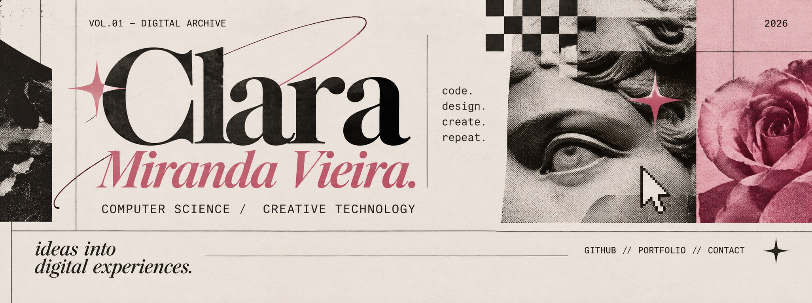

<!-- ================================================== -->
<!--                  CLARA / DIGITAL ARCHIVE            -->
<!-- ================================================== -->

  

  <b>COMPUTER SCIENCE STUDENT · DEVELOPER · CREATIVE THINKER</b>
   
  Exploring the intersection of technology, creativity and design.

  <code>SOFTWARE DEVELOPMENT</code>
  <code>ARTIFICIAL INTELLIGENCE</code>
  <code>DIGITAL DESIGN</code>

  <a href="#about">ABOUT</a> &nbsp; / &nbsp;
  <a href="#toolkit">TOOLKIT</a> &nbsp; / &nbsp;
  <a href="#projects">PROJECTS</a> &nbsp; / &nbsp;
  <a href="#interests">INTERESTS</a> &nbsp; / &nbsp;
  <a href="#contact">CONTACT</a>

 

<!-- ==================== 01 / ABOUT ==================== -->

<h2>01 / ABOUT</h2>

<h1><i>Behind the code.</i></h1>

Hi, I'm Clara!

I'm a Computer Science student at **Unisinos**, based in Brazil.

I'm interested in software development, technology and creative problem-solving. I enjoy exploring new ideas, learning different technologies and building projects that combine functionality with thoughtful design.

Beyond programming, I'm also interested in fashion, architecture, music and visual culture. I believe these different fields offer new perspectives on how we create and interact with technology.

  <b>A FEW THINGS I LOVE</b>
    
  <code>TECHNOLOGY</code>
  <code>FASHION</code>
  <code>ARCHITECTURE</code>
  <code>MUSIC</code>
  <code>VISUAL DESIGN</code>

<!-- ==================== 02 / TOOLKIT ================== -->

<h2>02 / TOOLKIT</h2>

<h1><i>Tools of the trade.</i></h1>

The technologies I use to explore, experiment and build.

**01 — LANGUAGES & WEB**

  
  
  

**02 — DEVELOPMENT TOOLS**

  
  
  

<!-- ==================== 03 / PROJECTS ================= -->

<h2>03 / SELECTED WORK</h2>

<h1><i>Ideas in progress.</i></h1>

A collection of personal projects, experiments and things I've built along the way.

### 001 — snake.exe

**A classic game, reimagined.**

A browser-based Snake game developed with HTML, CSS and JavaScript.

Featuring multiple game modes, difficulty levels, keyboard controls and gameplay improvements across its versions.

  
  

<!-- ==================== 04 / INTERESTS ================ -->

<h2>04 / BEYOND TECHNOLOGY</h2>

<h1><i>Curiosity has no boundaries.</i></h1>

Things that inspire the way I think, create and explore.

| FIELD | INTERESTS |
|:---|:---|
| DESIGN | Visual culture, graphic design and aesthetics |
| FASHION | Fashion history, editorials and creative direction |
| ARCHITECTURE | Spatial design and accessibility |
| MUSIC | Music discovery and musical instruments |
| TECHNOLOGY | Artificial intelligence and digital experiences |

<!-- ==================== FOOTER ======================= -->

  <i>A personal archive of code, ideas and digital projects.</i>
    
  CLARA MIRANDA VIEIRA · VOL. 01 · 2026

