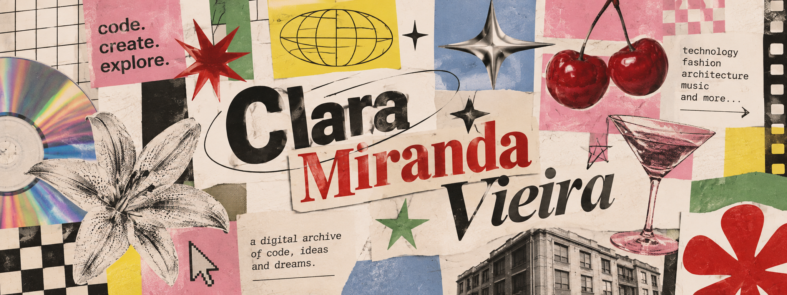

<!-- ================================================= -->
<!--              CLARA / DIGITAL ARCHIVE              -->
<!-- ================================================= -->

  

  <b>COMPUTER SCIENCE STUDENT · DEVELOPER · CREATIVE THINKER</b>
   
  Exploring the intersection of technology, creativity and design.

  <code>SOFTWARE DEVELOPMENT</code>
  <code>ARTIFICIAL INTELLIGENCE</code>
  <code>DIGITAL DESIGN</code>

  <a href="#about">ABOUT</a> &nbsp; / &nbsp;
  <a href="#toolkit">TOOLKIT</a> &nbsp; / &nbsp;
  <a href="#projects">PROJECTS</a> &nbsp; / &nbsp;
  <a href="#academic">ACADEMIC WORKS</a> &nbsp; / &nbsp;
  <a href="#interests">INTERESTS</a>

 

<!-- ==================== 01 / ABOUT ==================== -->

<h2>01 / ABOUT</h2>

<h1><i>Behind the code.</i></h1>

Hi, I'm Clara!

I'm a Computer Science student at **Unisinos**, based in Brazil.

I'm interested in software development, technology and creative problem-solving. I enjoy exploring new ideas, learning different technologies and building projects that combine functionality with thoughtful design.

Beyond programming, I'm also interested in fashion, architecture, music and visual culture. I believe these different fields offer new perspectives on how we create and interact with technology.

**LANGUAGES**

- Portuguese — Native
- English — C2
- French — A1

<!-- ==================== 02 / TOOLKIT ================== -->

<h2>02 / TOOLKIT</h2>

<h1><i>Tools of the trade.</i></h1>

Technologies and tools I use to explore, experiment and build.

**01 — PROGRAMMING & WEB DEVELOPMENT**

  
  
  
  
  
  
  

**02 — DATABASES & BACKEND**

  
  
  

**03 — DEVELOPMENT TOOLS**

  
  
  

<!-- ==================== 03 / PROJECTS ================= -->

<h2>03 / SELECTED PROJECTS</h2>

<h1><i>Ideas into reality.</i></h1>

A selection of personal projects, experiments and digital experiences.

### 001 — snake.exe

**A classic game, reimagined.**

A browser-based Snake game developed with HTML, CSS and JavaScript.

Featuring multiple game modes, difficulty levels, keyboard controls, a timer and different gameplay experiences.

  
  

### 002 — CTRL+FASHION

**Fashion, culture and digital exploration.**

An independent digital publication concept exploring fashion, visual culture, trends, designers and creative expression.

<code>IN DEVELOPMENT</code>

### 003 — AccessPath

**Rethinking accessibility and mobility.**

An academic project concept exploring how digital technology can contribute to accessible architecture and improve everyday urban mobility.

<code>IN DEVELOPMENT</code>

<!-- ==================== 04 / ACADEMIC WORKS =========== -->

<h2>04 / ACADEMIC WORKS</h2>

<h1><i>Learning by building.</i></h1>

A collection of academic projects, practical assignments and experiments developed throughout my education.

**01 — UNISINOS**

Computer Science projects, programming assignments and academic experiments.

*Projects will be added as they are developed.*

**02 — SENAC**

Technical education projects and practical experiences developed during my technical studies.

*Projects will be added as they are organized.*

<!-- ==================== 05 / INTERESTS ================ -->

<h2>05 / BEYOND TECHNOLOGY</h2>

<h1><i>Curiosity has no boundaries.</i></h1>

Things that inspire the way I think, create and explore.

| FIELD | INTERESTS |
|:---|:---|
| DESIGN | Visual culture, graphic design and aesthetics |
| FASHION | Fashion history, editorials and creative direction |
| ARCHITECTURE | Spatial design and accessibility |
| MUSIC | Music discovery and musical instruments |
| TECHNOLOGY | Artificial intelligence and digital experiences |
| CULTURE | Cinema, games, literature and art |

<!-- ================================================= -->
<!--                    END OF FILE                     -->
<!-- ================================================= -->
